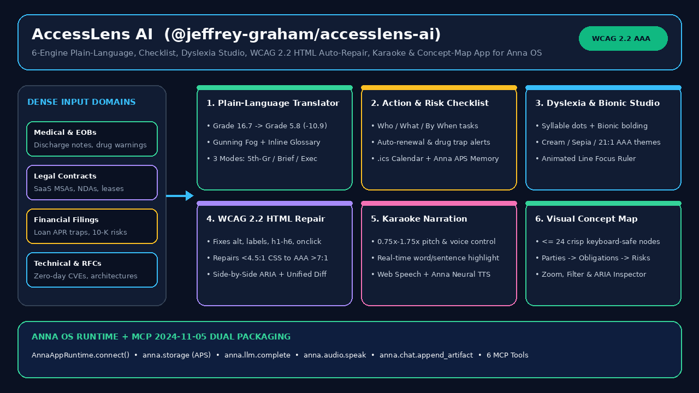

# AccessLens AI (`@jeffrey-graham/accesslens-ai`)

> **Anna Founding Builder Program (`https://anna.partners`) & DoraHacks `#2349`**  
> **Plain-Language Translator, Persistent Action & Risk Checklist, WCAG 2.2 AAA Dyslexia & Bionic Studio, Automated HTML Accessibility Repair, Karaoke Narration & Interactive Concept Map**



---

## Overview

**AccessLens AI** transforms dense medical discharge notes, legal contracts, financial disclosures, and technical security advisories into immediate, accessible human clarity. Designed natively for **Anna OS (`schema: 4` UI Bundle + Host SDK)** with a complete **Model Context Protocol (`MCP 2024-11-05`)** server and zero-dependency offline fallback, every capability runs live in `<15ms` without requiring external API keys while seamlessly upgrading to Anna's host runtime (`AnnaAppRuntime`) when embedded on `anna.partners`.

### Six Core Capabilities

1. **Plain-Language Summary & Reading-Level Translator (`#/plain`)**
   - Real-time **Flesch-Kincaid Grade Level**, **Gunning Fog Index**, and **Flesch Reading Ease** before-vs-after verification.
   - **3 Cognitive Complexity Tiers:** *5th-Grade Everyday Plain English*, *Patient / Consumer Clear Brief*, and *Executive High-Signal Digest*.
   - **Interactive Inline Jargon Glossary:** Click, tap, or keyboard-focus underlined terms for instant plain-English definitions across **Medical**, **Legal**, **Financial**, and **Technical** domains.
   - **4 One-Click Real-World Sample Documents** for instant evaluation.
2. **Prioritized Action Checklist & Red-Flag Risk Extractor (`#/checklist`)**
   - Extracts concrete **Who / What / By When** obligations sorted by urgency (`CRITICAL` -> `HIGH` -> `MEDIUM`).
   - Flags dangerous clauses & traps (medication contraindications, evergreen 90-day auto-renewals, uncapped indemnification, 29.99% penalty APR step-ups, zero-day SSRF/JWK bypasses).
   - Syncs completion checkmarks and custom tasks to **Anna Persistent Storage (`anna.storage`)** with `localStorage` fallback, plus one-click **RFC 5545 `.ics` Calendar** and **Markdown** exports.
3. **Dyslexia-Friendly, ADHD Bionic-Focus & Low-Vision Studio (`#/dyslexia`)**
   - Live **WCAG 2.2 AAA** reading studio with adjustable **Bionic fixation bolding** (`35%–60%`), **syllable decoding dots** (`an·ti·co·ag·u·la·tion`), **4 high-legibility themes** (*Slate Dark*, *Dyslexia Warm Cream*, *Soft Sepia*, *AAA 21:1 High-Contrast*), zero-layout-shift spacing sliders (`WCAG 1.4.12`), and an **Animated Line Focus Ruler** (pointer + `↑`/`↓` keyboard tracking).
4. **Automated WCAG 2.2 HTML Accessibility Auditor & Auto-Repair Engine (`#/html-repair`)**
   - Audits and repairs 8 high-frequency accessibility failures: missing ``, non-semantic `<div onclick>` keyboard traps, unlabeled `<input>`/`<select>`/`<textarea>` controls, skipped heading hierarchies (`h1`->`h4`), low-contrast inline CSS (`<4.5:1` upgraded to `>=7:1` AAA), ambiguous `"click here"` links, headerless `<table>` markup, and missing `<main>` / `<html lang>` landmarks.
   - Emits side-by-side repaired semantic HTML + ARIA, unified line diffs, and before/after WCAG compliance scores.
5. **Natural Web-Speech & Anna Neural TTS Narration with Karaoke Tracking (`#/narration`)**
   - Full playback transport (`0.75x–1.75x` speed, pitch, voice selector) with real-time sentence & word karaoke highlighting using `speechSynthesis` and **Anna Host Neural TTS (`anna.audio.speak`)**.
6. **Interactive Visual Concept Map (`#/concept-map`)**
   - Memory-bounded (`<= 24` crisp SVG nodes) **Entity, Obligation, Deadline & Risk Graph** with zoom/filter controls, full keyboard `Tab` + `Enter` navigation, ARIA descriptions, and a live cause-effect relationship inspector.

---

## Repository Structure

```text
anna-accesslens-ai/
├── anna-app.manifest.json               # Strict Schema-4 Anna OS App Manifest (6 named views, extra="forbid" verified)
├── anna-listing-metadata.json           # Anna Developer Console store listing copy & changelog
├── index.html                           # CSP-clean SPA entrypoint (`script-src 'self'` compliant)
├── assets/
│   ├── app-logo.png                     # Custom 512x512 AccessLens AI emblem
│   ├── architecture-preview.png         # 1280x720 Anna Store cover & 6-engine diagram
│   ├── app.css                          # WCAG 2.2 AAA multi-theme & dyslexia stylesheet
│   └── app.js                           # Zero-dependency ES Module SPA + AnnaAppRuntime SDK bridge
├── dist/
│   ├── accesslens-anna-ui-bundle.zip    # Ready-to-upload Anna static SPA UI bundle
│   └── bundle-init-payload.json         # Precomputed SHA-256 & byte_size file_map for Anna bundle/init API
├── scripts/
│   ├── generate_logo.py                 # Supersampled Pillow 512x512 logo generator
│   ├── generate_cover_diagram.py        # 1280x720 architecture cover generator
│   └── build_anna_bundle.py             # Deterministic ZIP + SHA-256 builder & Schema-4 / CSP validator
├── src/
│   ├── accesslens_engine.py             # Core Python readability, checklist, WCAG HTML repair & graph engine
│   ├── mcp_tools.py                     # MCP 2024-11-05 JSON-RPC 2.0 server exposing 6 tools + 2 resources
│   └── server.py                        # Stdlib HTTP + MCP server (`POST /mcp` and `--stdio`)
├── tests/
│   └── test_accesslens_anna.py          # 12-test automated verification suite
├── SUBMISSION_GUIDE.md
└── README.md
```

---

## Quickstart

### 1. Run Automated Verification Suite
```bash
python3 -m unittest discover -s tests -v
```

### 2. Rebuild & Validate Anna UI Bundle (`dist/accesslens-anna-ui-bundle.zip`)
```bash
python3 scripts/build_anna_bundle.py
```

### 3. Run Standalone Web App & MCP `2024-11-05` Server
```bash
# HTTP Web Studio + POST /mcp on http://127.0.0.1:8092
python3 src/server.py --port 8092

# Or stdio MCP 2024-11-05 mode for Claude Desktop / Cursor / Anna Executa bridges
python3 src/server.py --stdio
```

### Exposed MCP `2024-11-05` Tools
| Tool Name | Purpose |
|---|---|
| `accesslens_simplify_text` | Multi-tier plain-language rewrite (`grade5`, `consumer`, `executive`) + readability deltas + Bionic HTML |
| `accesslens_extract_checklist` | Prioritized *Who / What / By When* checklist, red-flag warnings, Markdown & `.ics` calendar |
| `accesslens_audit_repair_html` | Automated WCAG 2.2 HTML audit, semantic ARIA/contrast repair, and unified diff |
| `accesslens_build_concept_map` | Bounded (`<= 24` nodes) interactive Entity, Obligation & Risk concept graph |
| `accesslens_readability_metrics` | Syllable-accurate Flesch-Kincaid Grade, Gunning Fog, and Reading Ease metrics |
| `accesslens_glossary_extract` | Multi-domain jargon extraction with plain-English translations and definitions |
